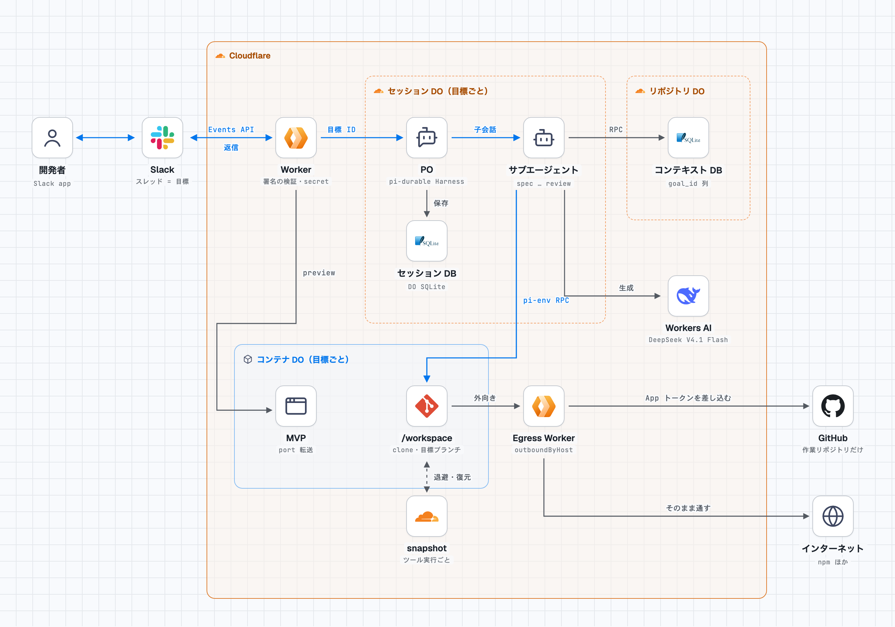
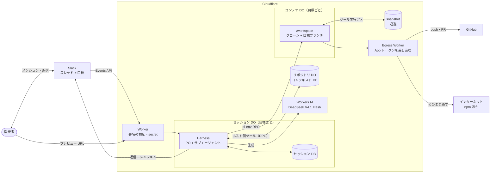
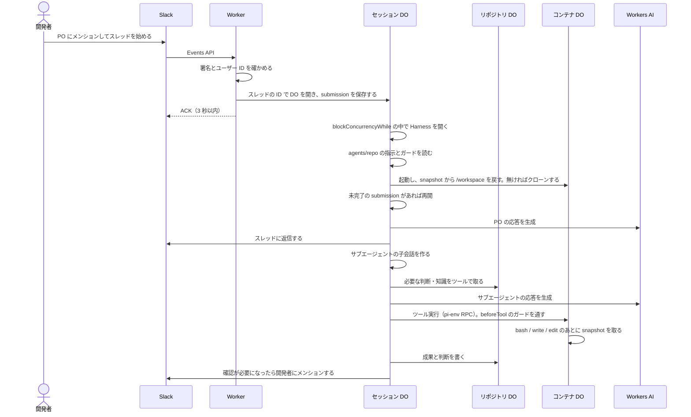
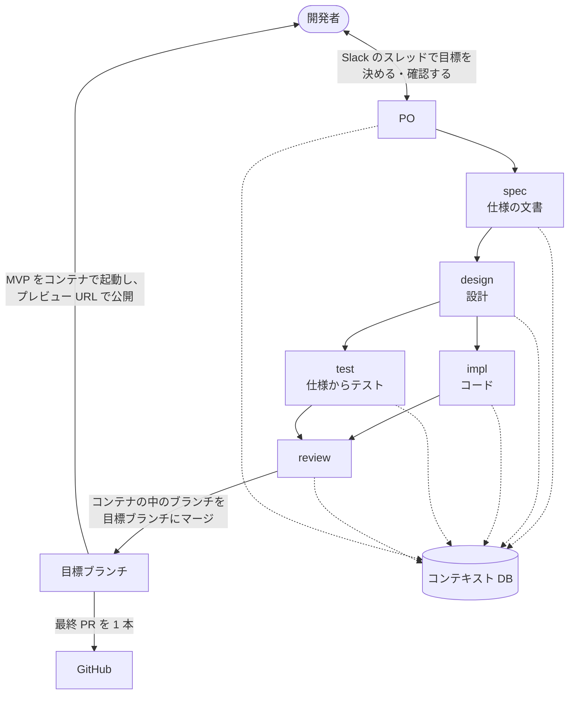

# 全体像

開発者が何をするとエージェントが起動し、どこで定義されたものがどう動くかをまとめる。要件は [requirements.md](requirements.md)、配置の判断は [ADR 0002](../adr/pi-durable-dev-env/0002-run-on-cloudflare.md)、実装の状況と未決の項目は [roadmap.md](roadmap.md) にある。ここに書く内容は計画で、まだ実装していない（ローカル版の M1〜M3 は roadmap.md の記録に残す）。



## 置き場所

本体と設定はこのリポジトリに置き、Worker と一緒にデプロイする。データと作業リポジトリは Cloudflare の上にある。コンテナに入るのは作業リポジトリのクローンだけなので、エージェントのシェルから本体、設定、DB、資格情報には届かない。

| もの | 場所 | 単位 |
|---|---|---|
| Worker のコード、`agents/<repo>/` | このリポジトリ → デプロイ | — |
| Workers AI を呼ぶ Cloudflare の API トークン、GitHub App の秘密鍵、Slack の署名シークレットと bot トークン | Worker の secret | — |
| セッション DB（Harness） | セッション DO | 目標ごと |
| コンテキスト DB | リポジトリ DO | 作業リポジトリごと |
| クローンと目標ブランチ | コンテナ DO の `/workspace` | 目標ごと |
| `/workspace` の退避 | コンテナの snapshot | 目標ごと |

`<repo>` は GitHub の remote URL で識別する。



## 開発者がすること

最初に一度:

```sh
git clone git@github.com:Hol1kgmg/pi-agent-filed.git
cd pi-agent-filed
# Slack App を作り、ワークスペースに入れる
# GitHub App を作り（Contents と Pull requests の Read and write だけ）、作業リポジトリにだけインストールする
# Worker の secret に Workers AI の権限だけの Cloudflare API トークンとアカウント ID、GitHub App の ID と秘密鍵とインストール ID、
#   Slack の署名シークレットと bot トークン、許可する Slack のユーザー ID を登録する
# デプロイする
```

作業リポジトリごとに一度:

```sh
# agents/my-app/ に指示とガードの設定を置いてコミットし、デプロイする
```

目標ごと:

1. Slack で PO にメンションしてスレッドを始め、作業リポジトリと目標を書く
2. スレッドで PO と対話して目標を決める。あとはメンションを待ち、MVP をプレビュー URL で確認し、最終 PR をレビューする

具体的なコマンドは roadmap.md の M11、M13、M14 で決める。

## 起動してから動くもの

PO とサブエージェントは、同じセッション DO の同じ Harness の中で、別の会話として動く。durable のストレージを開けるのが 1 つの持ち主だけだからである。モデルの呼び出しと DB の読み書きは DO で行い、コンテナに届くのはツールの実行（シェル、ファイル編集）だけである。



## どこで何を定義するか

| もの | 定義する場所 | 誰が変えるか | コンテナから |
|---|---|---|---|
| 会話ループ、Slack と Webhook の入口、サブエージェントの起動、ツール | Worker のコード | 開発者 | 見えない |
| 役割ごとのモデルと基本の指示 | 本体 | 開発者 | 見えない |
| リポジトリ固有の指示とガードの設定 | `agents/<repo>/` | 開発者 | 見えない |
| App トークンを差し込む先（GitHub のホスト）と、トークンの範囲 | Egress Worker のコード | 開発者 | 見えない |
| 実行環境（イメージ、依存、pi-env） | コンテナのイメージ（touka の `sandbox.Dockerfile` から写す） | 開発者 | 見えない |
| 資格情報 | Worker の secret | 開発者 | 見えない |
| 会話ログと再開の状態 | セッション DB | セッション DO | 見えない |
| 知識・判断・タスク・目標の記録 | コンテキスト DB | エージェントがホスト側のツールで | 見えない |
| 仕様の文書 | `/workspace`（作業リポジトリの git） | spec | 書ける |

データの単位と寿命は、[requirements.md](requirements.md) の「コンテキストの要件」にある。

## 1 つの目標が流れる様子



サブエージェントは作業の単位ごとに新しい子会話で起動し、終わるときに成果と判断をコンテキスト DB に書く。親の会話には最終の報告だけが返る。次に起動するエージェントは、自分が前に下した判断も他の役割の判断も、同じ DB から取る。
