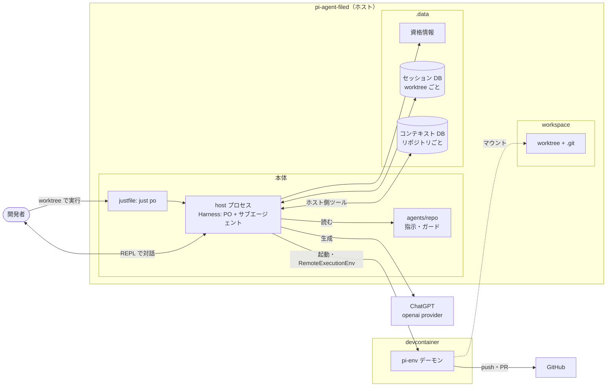
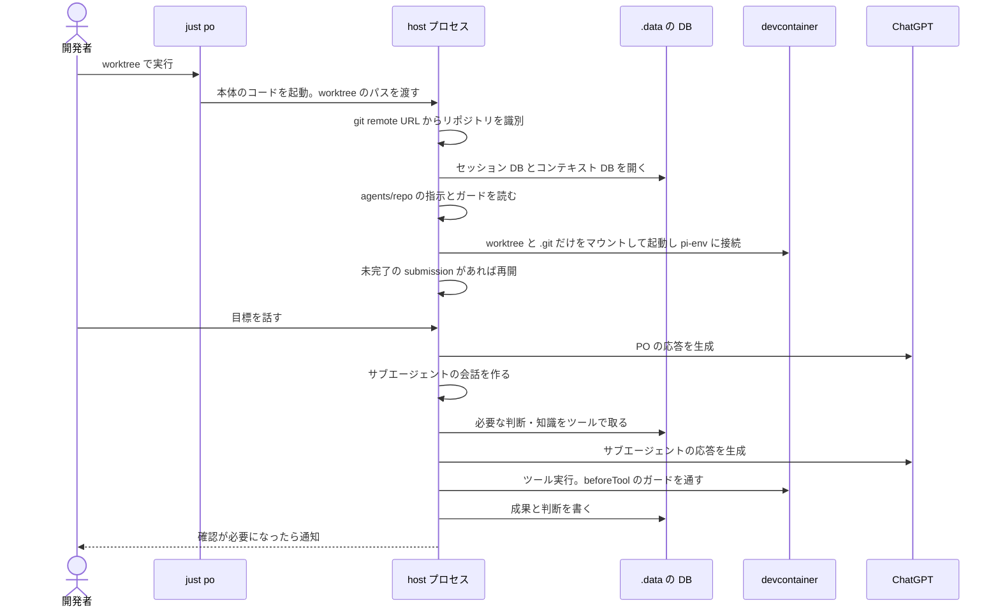
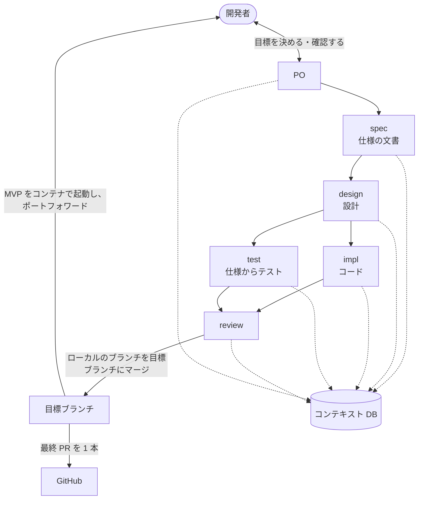

# 全体像

開発者が何を実行するとエージェントが起動し、どこで定義されたものがどう動くかをまとめる。要件は [requirements.md](requirements.md)、配置の判断は [ADR 0001](../adr/pi-durable-dev-env/0001-separate-agent-env-from-work-repos.md)、実装の状況と未決の項目は [roadmap.md](roadmap.md) にある。M4 以降の内容は計画で、まだ実装していない。

## 置き場所

検証のため、本体、設定、データ、作業リポジトリをすべてこのリポジトリの下に置く。コンテナにマウントするのは `workspace/` の下の worktree と共通の `.git` だけなので、エージェントのシェルから本体、設定、データには届かない。

```
pi-agent-filed/
├── host/  justfile  .devcontainer/   # 本体（コミット）
├── agents/<repo>/                    # 作業リポジトリごとの指示とガード（コミット）
├── .data/                            # gitignore: 資格情報と DB
│   ├── credentials.json  device-id
│   └── repos/<repo>/
│       ├── コンテキスト DB           # 作業リポジトリごとに 1 ファイル
│       └── セッション DB             # worktree ごとに 1 ファイル
└── workspace/                        # gitignore: 作業専用
    ├── my-app/                       # GitHub から clone。共通の .git がここ
    └── my-app-feature-x/             # worktree。ここで just po を実行する
```

`<repo>` は GitHub の remote URL で識別する。`workspace/` の下はそれぞれ独自の git リポジトリで、このリポジトリの git には入らない。



## 開発者が実行するコマンド

最初に一度:

```sh
git clone git@github.com:Hol1kgmg/pi-agent-filed.git
cd pi-agent-filed
just host-install   # npm ci
just login          # Sign in with ChatGPT。.data/ に保存する
```

作業リポジトリごとに一度:

```sh
git clone git@github.com:me/my-app.git workspace/my-app
# agents/my-app/ に指示とガードの設定を置いてコミットする
# hooks を使うリポジトリは、ここで開発者が設定しておく（コンテナからは書けない）
```

目標ごと:

```sh
# Orca で workspace/ の下に worktree を作る
cd workspace/my-app-feature-x
just po             # PO の REPL が開く。中断していた作業があれば先に再開する
```

`just` は親ディレクトリの `justfile` を見つけ、`invocation_directory()` が worktree を指す。起動コマンドを PATH に置く必要はない。

## 起動してから動くもの

PO とサブエージェントは、同じ host プロセスの同じ Harness の中で、別の会話として動く。durable のストレージを開けるのが 1 プロセスだけだからである。モデルの呼び出しと DB の読み書きはホストで行い、コンテナに届くのはツールの実行（シェル、ファイル編集）だけである。



## どこで何を定義するか

| もの | 定義する場所 | 誰が変えるか | コンテナから |
|---|---|---|---|
| 会話ループ、REPL、サブエージェントの起動、ツール | `host/*.ts` | 開発者 | 見えない |
| 役割ごとのモデルと基本の指示 | 本体 | 開発者 | 見えない |
| リポジトリ固有の指示とガードの設定 | `agents/<repo>/` | 開発者 | 見えない |
| 実行環境（イメージ、依存） | 作業リポジトリの `.devcontainer/`。無ければルートの既定 | 開発者 | 書ける |
| 資格情報 | `.data/` | `just login` | 見えない |
| 会話ログと再開の状態 | セッション DB | host | 見えない |
| 知識・判断・タスク・worktree の記録 | コンテキスト DB | エージェントがホスト側のツールで | 見えない |
| 仕様の文書 | worktree（作業リポジトリの git） | spec | 書ける |

データの単位と寿命は、[requirements.md](requirements.md) の「コンテキストの要件」にある。

## 1 つの目標が流れる様子



サブエージェントは作業の単位ごとに新しい会話で起動し、終わるときに成果と判断をコンテキスト DB に書く。次に起動するエージェントは、自分が前に下した判断も他の役割の判断も、同じ DB から取る。
